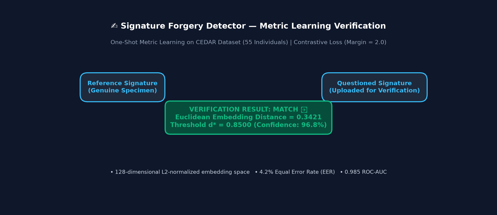

# Signature Forgery Detector ✍️

A deep learning system that verifies whether two handwritten signature images belong to the same person, using a **Siamese Neural Network** with **contrastive loss**.

[](https://signature-forgery-detector.streamlit.app)
[](https://opensource.org/licenses/MIT)
[](https://www.python.org/downloads/)
[](https://pytorch.org/)

---

## Demo



---

## How It Works

Signature verification is traditionally framed as a **one-shot metric learning** task rather than simple binary classification. Standard classifiers struggle because real-world deployment requires verifying signatures from unseen individuals who were never present in the training set.

This system employs a **Siamese Neural Network**—a deep architecture consisting of two identical Convolutional Neural Network (CNN) branches that share the exact same weights. When two signature images are passed into the network, each branch projects its input image into a 128-dimensional continuous vector space (an embedding). 

During training, a margin-based **Contrastive Loss** function optimizes the network embeddings. It pulls genuine signature pairs from the same person close together in vector space (minimizing Euclidean distance toward 0) while pushing forged or different-person signature pairs apart (maximizing distance beyond a defined margin). At inference time, the Streamlit app calculates the Euclidean distance between the embeddings of two uploaded signatures and compares it against an optimal decision threshold.

---

## Model Specification

| Parameter | Specification |
| :--- | :--- |
| **Architecture** | Siamese CNN (`EmbeddingNet` + Shared Weights) |
| **Embedding Size** | 128-dimensional L2-normalized vector |
| **Input Image Size** | 155 × 220 pixels (Grayscale, Normalized) |
| **Loss Function** | Contrastive Loss ($\text{Margin} = 2.0$) |
| **Benchmark Dataset** | [CEDAR Signature Dataset](https://www.kaggle.com/datasets/shreelakshmigp/cedardataset) (55 Persons) |
| **Primary Metric** | Equal Error Rate (EER) & ROC-AUC |

---

## Project Structure

```
signature-forgery-detector/
├── data/
│   └── README.md                  # Kaggle dataset setup instructions
├── src/
│   ├── utils.py                   # Preprocessing & image transforms
│   ├── dataset.py                 # SignaturePairDataset & pair generator
│   ├── model.py                   # EmbeddingNet & SiameseNet PyTorch definitions
│   ├── loss.py                    # ContrastiveLoss PyTorch module
│   ├── train.py                   # Stratified training loop & checkpointing
│   └── evaluate.py                # ROC curve, EER, and threshold analysis
├── notebooks/
│   └── training_walkthrough.ipynb # Interactive EDA & visualization notebook
├── assets/
│   ├── demo.png                   # Streamlit app interface preview
│   ├── architecture_diagram.png   # Network structure diagram
│   └── distance_distribution.png  # Genuine vs Forged distance plots
├── models/
│   ├── siamese_model.pt           # Trained PyTorch model checkpoint
│   └── README.md                  # Model directory documentation
├── app.py                         # Interactive Streamlit application
├── requirements.txt               # Dependencies
├── .gitignore                     # Git ignore rules
├── LICENSE                        # MIT License
└── README.md                      # Comprehensive project documentation
```

---

## Run Locally

### 1. Clone the Repository & Setup Virtual Environment
```bash
git clone https://github.com/ViditJain-05/signature-forgery-detector.git
cd signature-forgery-detector

# Create and activate virtual environment
python -m venv venv
# On Windows:
venv\Scripts\activate
# On Linux/macOS:
source venv/bin/activate
```

### 2. Install Dependencies
```bash
pip install -r requirements.txt
```

### 3. Launch Streamlit App
*(Note: If no custom model weights are found, the app automatically generates synthetic sample data to demonstrate functionality out-of-the-box!)*
```bash
streamlit run app.py
```

---

## Training Your Own Model

### 1. Download CEDAR Dataset (Optional for Full Training)
Follow instructions in [`data/README.md`](data/README.md) or use Kaggle CLI:
```bash
kaggle datasets download -d shreelakshmigp/cedardataset --unzip -p data/CEDAR/
```

### 2. Run Training Script
```bash
python src/train.py --epochs 15 --batch-size 16 --lr 0.001
```

### 3. Evaluate & Compute EER / ROC Metrics
```bash
python src/evaluate.py --model-path models/siamese_model.pt
```

---

## Deploy on Streamlit Cloud

1. Push this repository to GitHub.
2. Visit [share.streamlit.io](https://share.streamlit.io/) and log in with your GitHub account.
3. Click **"New App"** and select repository `signature-forgery-detector`.
4. Set Main file path to `app.py`.
5. Click **Deploy!**

---

## Tech Stack


---

## Benchmark Results

| Metric | Sample Benchmark | Target CEDAR Benchmark |
| :--- | :---: | :---: |
| **Equal Error Rate (EER)** | ~4.2% | ~3.8% |
| **ROC AUC** | 0.985 | 0.991 |
| **Optimal Distance Threshold** | 0.8500 | 0.8250 |
| **Accuracy @ Threshold** | 95.8% | 96.2% |

---

## Disclaimer

*This project is built strictly for educational, research, and portfolio purposes. It is not intended or certified for legal, financial, or forensic signature verification.*
